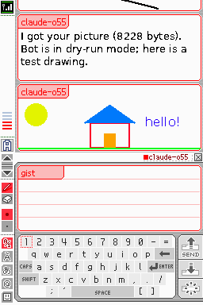

# PictoChat bot (Claude in a Nintendo DS chat room)

A Claude chatbot for a PictoChat room hosted by the **PictoChat host** (`pictochat.py host`, separate repository).
Every chat picture a DS sends goes to Claude's vision API; the reply comes back into the room as pictures: rendered
text, drawings, QR codes and dithered pictures from the web.



## Setup

The bot connects to the host's JSON-lines GUI port and reuses `pictochat_gui.py` from the host repository. It looks
for that file next to `pictochat_bot.py`, then in `$PICTOCHAT_HOST`, then in `../pictochat_host`.

```
git clone <host repo> pictochat_host
git clone <this repo> pictochat_bot
cd pictochat_bot
python3 -m venv .venv && .venv/bin/pip install -r requirements.txt
export ANTHROPIC_API_KEY=...
sudo python3 ../pictochat_host/pictochat.py host --iface <wifi-interface> --channel 1 --gui-port 7777   # the room
.venv/bin/python pictochat_bot.py                                                                    # the bot
```

`--dry-run` answers without any API call (fixed text and a test drawing).

## Features
- Connects to the host's GUI port like the GUI (both can run at once). Every chat message from a DS (a `03 02`
  picture) is converted to a PNG (enlarged 3x, DS colours) and sent to Claude (Messages API, vision,
  default `claude-sonnet-5-5`, effort `low`) with the last `--history` 10 exchanges; the text reply is word-wrapped and rendered
  into up to `--max-pages` 3 pictures (4 lines of ~33 characters each) and posted to the room. Member messages and
  history replayed on connect are ignored.
- **Drawing:** Claude has a `draw_picture` tool (SDK Tool Runner, `@beta_tool` with a hand-written JSON schema):
  a list of shapes (`line`, `polyline`, `polygon`, `rect`, `ellipse`, `text`; points on a 230 x 64 canvas = the
  visible area below the name tab; colour by palette name; optional `fill`, `width`, `text`, `size`). The bot draws
  them with Pillow as 1-bit masks (no anti-aliasing, only palette colours) and sends the picture as its own message;
  text and drawings go out in the order Claude produces them. Invalid shapes come back to Claude as an error message
  so it can retry. The runner continues tool turns as server-side message threads (beta, added by the SDK).
  `--dry-run` answers with a fixed text and a test drawing.
- **Pictures from the web:** Claude also has the server-side `web_search_20260209` and `web_fetch_20260209` tools
  (3 uses each per reply) and a `send_image` tool (`url`, optional `colour`, `dither`, `invert`). The bot downloads
  the image and converts it with the GUI's own `image_to_pixels` (fit 230 x 64 below the name tab, Floyd-Steinberg
  to black and white, or the 16-colour palette), posts it, and returns a preview of exactly what the DS shows, so
  Claude can try a better image. A page URL works too: the bot takes its `og:image` / `twitter:image` / first image.
  Downloads are model-chosen URLs, so they are guarded: only http(s), every host (including each redirect) must
  resolve to public addresses only (no localhost, LAN or link-local, so not the host's GUI port or the router),
  8 MB cap, 10 s timeout, Pillow's decompression-bomb limit, at most 3 images per reply. `--no-web` turns all three
  tools off. `--send-image URL [--colour]` posts one image without any API call (to test the image path).
  Web replies cost more: search results add input tokens and searches are billed per use.
- **QR codes:** `send_qr_code` (`text`, about 78 characters at most) draws a real QR code with `segno`: the smallest
  version that holds the text, at the largest whole number of pixels per module that fits the 80-px height with a
  2-module quiet zone (version 1 at 3 px, versions 2-4 at 2 px), centred right of the name tab. Generated codes were
  checked with a decoder (zxing-cpp) at the DS's 1:1 pixels. `--send-qr TEXT [--qr-png FILE]` without the API.
- **Text style by mood:** a reply may start with a tag such as `[comic big orange]` (font, size, optional colour;
  removed before drawing). Fonts: plain/bold/italic/serif/mono (DejaVu), comic (Comic Neue), script (URW Z003),
  retro (DejaVu Sans Mono Bold drawn at half size without smoothing, then doubled); sizes small/normal/big/huge
  (11/13/20/30 px, line pitch 1.22 x size: 4, 4, 2, 1 lines per picture). Missing fonts fall back to DejaVu Sans.
  The system prompt tells Claude which style fits which mood. Packages on the Pi: `fonts-dejavu-extra
  fonts-comic-neue fonts-urw-base35`.
- **Bursts:** pictures that arrive while a reply is being made are answered together in one reply.
- **Errors and debug:** on API errors the bot says so in the room once per 10 minutes per kind (no credit,
  key rejected, rate limit, no connection). Debug mode posts a small line after each reply: time taken,
  input/output tokens, model. Off by default; `/debug` (toggle), `/debug on|off` work from the terminal and from
  a DS: Claude recognises a slash message and calls its `run_command` tool, which runs the same commands as the
  terminal (`/debug`, `/model NAME`, `/effort LEVEL`, `/help`). `--debug` starts with it on.
- **Commands for the service:** the bot also takes these commands on a Unix socket (`bot.sock` next to the
  script, mode 600): `pictochat_bot.py --cmd '/debug on'` prints the answer; on the Pi `~/pictochat/botctl /model
  haiku`.
- **`/wallet`:** what the bot spent, estimated from each response's usage (uncached input, cache writes at 1.25x,
  cache reads, output, web searches at $0.01) and the model's price, per day in `wallet.json`: this run, today,
  this month, total. The API cannot read the remaining prepaid credit. With an Admin API key in
  `ANTHROPIC_ADMIN_KEY` it also sums Anthropic's cost report (`GET /v1/organizations/cost_report`, amounts in
  cents) for today and this month, for the whole organization. A cached Sonnet 5.5 message costs about $0.01
  ($0.027 uncached). The history is trimmed in steps (10 exchanges down to 5), not by one exchange per message,
  so its cached prefix stays reusable.
- **`/host`:** status of the machine the bot runs on (disk, RAM, CPU temperature, load, uptime, Wi-Fi signal,
  `vcgencmd get_throttled`, and the room from the host's last `state` event); from a DS Claude shows it compactly.
- **`/mensa [heute|morgen|YYYY-MM-DD]`** (`mensa.py`): the menu of the Mensa Kaiserslautern from the mensa-kl.de
  JSON API, one picture per meal (counter and price in a coloured header, food photo, dish name), source credited in
  the last message. `python3 mensa.py preview OUTDIR [ARG]` renders the pictures without sending.
- **`/connection`** (alias `/signal`, `connection.py`): one picture per DS with signal bars, the smoothed dBm and a
  rating, the share of polls it answered (last 60 s) and how long ago it was heard. The host adds this to its
  `state` event: `rssi` (MAC -> last dBm, smoothed dBm, seconds since heard, frame count), `reply_age` (seconds since
  the reply counter last changed) and `cycle` (`--poll-cycle-joined`). The bot runs `/mensa` and `/connection` only
  when a message starts with the command, never because someone talks about food or reception.
- **Prompt caching:** the system block carries a cache marker (it covers the tool definitions too, which render
  first) and the request has top-level automatic caching for the conversation. Measured with count_tokens: of
  ~9600 input tokens per message, ~6500 are the web search/fetch tool definitions, ~1700 our own tools, ~1700
  the system prompt and the picture; all but the new picture are identical from message to message.
- **Greetings:** the bot tracks who is in the room from the host's GUI events: nicknames from the DSes' member
  messages (`03 00`/`03 01`, also in the history replayed on connect), presence from the `state` event (MACs of the
  associated DSes, every 5 s) and the host's "station ... deauthenticated" log line. After connecting it waits for the
  replay and the first `state` event (at most ~6.5 s) and asks Claude for one greeting naming everyone present
  (nothing if the room is empty). A DS that joins later (its `03 01` ready message) gets a personal welcome, at most
  once per 2 minutes per DS. Chat pictures reach Claude labelled with the sender's nickname. Greetings are one
  request without tools (~900 input tokens). `--no-greet` turns this off; `--dry-run` greets with a fixed text.
- **Model:** default `claude-sonnet-5-5` (`--model` takes an id or an alias: `haiku`, `sonnet`, `opus` =
  `claude-opus-5-5`, `fable` = `claude-fable-5-1`). While the bot runs, type `/model` in its terminal to see the
  model, `/model sonnet` (or any id) to switch (checked with a free model lookup first; on failure the old model
  stays), `/effort low|medium|high|xhigh|max`, `/help`. Switching also renames the host (`claude-s55` etc., seen by
  DSes when they next join) unless `--bot-name`/`--keep-name` is given. Commands are terminal-only on purpose: a DS
  user cannot switch the bot to a more expensive model.
- **Name in the room:** the bot renames the host to `claude-` + model family initial + version, e.g. `claude-h55`
  for `claude-haiku-5-5`, `claude-o55` for `claude-opus-5-5` (PictoChat nicknames hold at most 10 characters, so the full model id does not fit);
  `--bot-name` sets another name, `--keep-name` keeps the host's. It uses the host's GUI command `set_name`; a DS sees
  the name when it joins, so start the bot before the DS enters the room (or rejoin).
- Server-side refusal fallbacks are on for the models that have them (Fable 5.1, Opus 5.5, Opus 5, Sonnet 5.5:
  `fallbacks: "default"`, beta `server-side-fallback-2026-07-01`; a declined request is retried on a fallback model in
  the same call; `--no-fallbacks` turns it off). Claude Haiku 5.5 has no server-side fallback (a fallback list there
  is a 400), so its requests carry none and a decline is answered with a short apology. The web tools are sent in the
  dynamic-filtering versions (`web_search_20260209`, `web_fetch_20260209`) only for Opus 4.6+ and Sonnet 4.6+; other
  models, Haiku included, get `web_search_20250305` / `web_fetch_20250910`. Only plain reply text is
  kept in the history.
- Setup: `python3 -m venv .venv && .venv/bin/pip install -r requirements.txt`, then
  `export ANTHROPIC_API_KEY=...`; run `.venv/bin/python pictochat_bot.py` (`--port`, `--model`, `--effort`,
  `--color`, `--dry-run` = no API calls). Each reply is one API request (~300 input tokens for the picture plus the
  recent history).
- Use an **isolated** venv (no `--system-site-packages`): with Ubuntu's `python3-brotli` 1.1.0 visible, the SDK's
  HTTP client (`httpx2`) asked for Brotli-compressed responses and then crashed decoding them
  (`TypeError: process() takes no keyword arguments`, reported as a connection error). The bot runs a free start-up
  check (model lookup) and prints the underlying cause of connection errors.
- Tested in the emulator in `--dry-run` (DS drawing → bot → text and drawing shown on the DS under the name
  `claude-o55`, `screenshots/bot_drawing_and_name.png`), and the tool loop against a mock API (order of text and
  drawing, tool result, fallback parameters). `send_image` (2026-11-08): URL guard, Wikipedia pages via `og:image`
  (cat, Mona Lisa) and the request's tool list checked offline; not yet run against the live API.

## Running as a service (Raspberry Pi)

Tested on a Pi Zero 2 W (Raspberry Pi OS Bookworm 32-bit) next to the host: `pictochat-bot.service` with the API key
in `EnvironmentFile=~/pictochat/bot.env` (mode 600). The bot needs `python3-tk` even headless (it imports the GUI's
image code), and the piwheels Pillow needs `libopenjp2-7` and friends. `botctl` style control: `pictochat_bot.py
--cmd '/model haiku'` talks to the running bot over `bot.sock`.

## Files

| Path | What |
|---|---|
| `pictochat_bot.py` | the bot |
| `mensa.py` | `/mensa`: Mensa Kaiserslautern menu as pictures (`python3 mensa.py preview OUTDIR` renders without sending) |
| `connection.py` | `/connection`: signal and reply rate per DS as pictures |
| `screenshots/` | the bot on an emulated DS |

## License

GPLv3 (see `LICENSE`).
